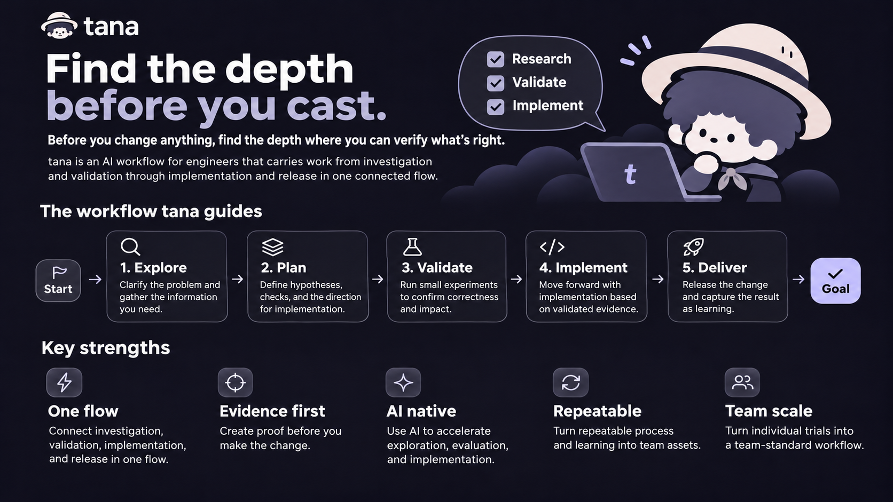

# tana



> Find the depth before you cast.

A tana is the depth where the fish are holding. An angler who skips finding it can cast all day and catch nothing.
In code, the depth is the check that tells you a change is right. tana is a working style for Claude Code: find the check first, then make the change. It comes with 33 skills, each called as `/tana:<name>`.

## The five pillars

| Pillar | In one line |
| :- | :- |
| 1. Sound the depth | Before the change, set up a way to check the result and look at the current state once |
| 2. Light tackle | The smallest diff the evidence justifies. Subtract before you add |
| 3. One rod | Keep the work in one loop. Spawn a subagent only for context flood, parallel pieces, or independent verification |
| 4. Log the catch | Turn an instruction given twice into structure (a test, hook, or script). Measure config changes with evals |
| 5. Keep the line moving | Reversible work proceeds and shows its result. Stop and ask only before what cannot be undone |

## Install

```
/plugin marketplace add snkrheadz/tana
/plugin install tana@tana
```

To use it, run `/tana:mode` or ask Claude to work "the tana way".

### Cloud sessions (claude.ai/code)

Cloud sessions do not install plugins. Instead, have the cloud environment's setup script place tana in `~/.claude/skills/tana`, and `tana:mode` loads as a skills-dir plugin (confirmed 2026-10-26).

```bash
#!/bin/bash
D="$HOME/.claude/skills/tana"
B=https://raw.githubusercontent.com/snkrheadz/tana/main/plugins/tana
mkdir -p "$D"
curl -fsSL "$B/FILES" | while read -r f; do
mkdir -p "$D/$(dirname "$f")"
curl -fsSL "$B/$f" -o "$D/$f" || echo "tana: failed $f"
done
echo "tana: $(find "$D" -type f | wc -l) files"
exit 0
```

The script reads the list of distributed files from `plugins/tana/FILES`. After adding a file, regenerate the list with `scripts/update-files.sh` (CI catches a stale list). The environment rebuilds its cache about every 7 days and fetches the latest version then.

## Skills

tana has 33 skills. If you are not sure which one fits, tell `/tana:guide` what you are doing and it points you to one.

| Group | Skills |
| :- | :- |
| Working style | `mode` (work the tana way), `guide` (which skill fits which task) |
| Tune the setup | `retie` (remove config items, rerun real tasks, keep only what changes behavior), `review-fit` (fit REVIEW.md and the CI review to what /code-review actually reads and returns) |
| Understand | `explain-code` (how the code works and where things live), `trace-why` (why it is this way, what broke it), `teach` (explain so a person understands), `plain-words` (restate the last reply plainly), `restate-goal` (restate the goal), `catch-up` (catch up on what happened while you were away), `rebuild-context` (rebuild your own context), `sharpen` (deepen a request) |
| Design and review | `sketch-design` (types and structure first), `compete` (pit several drafts against each other and graft the best parts), `fan-out` (research in parallel, report once), `stress-review` (attack the premises and the design), `blast-radius` (what breaks outside the diff), `plan-big-change` (an auditable plan for a large change) |
| Verify | `failing-test-first`, `vet-measurement` (check a performance number before trusting it), `create-verify-skill` / `maintain-verify-skill` (a verify skill that drives the app like a user), `create-formal-check` / `maintain-formal-check` (formal verification), `statechart` (check a state machine in TLA+ and draw it) |
| Learn and write | `lock-in-lessons` (make a repeated mistake impossible), `retro` (look back on a session), `decision-log` (record decisions in long work), `capture-my-style` (turn your own style into a skill), `comment-audit`, `cut-ai-tells` (cut mechanical phrasing), `tech-writing`, `typescript` |

Every skill except `mode`, `retie`, `review-fit`, and `typescript` is hidden from the model (`disable-model-invocation: true`) and loads only when called as `/tana:<name>`, so it costs no session context. `typescript` applies on its own when reading or editing `.ts`/`.tsx` files.

## Layout

```
plugins/tana/
├── skills/mode/
│   ├── SKILL.md       # entry point: the pillars and task routing
│   ├── pillars/       # detail per pillar (read only when needed)
│   ├── playbooks/     # steps for investigation, bug fix, feature, review findings, red checks, opening a PR
│   └── principles/    # design principles (read when a trigger in INDEX.md fires)
├── skills/<name>/     # the other skills (listed above)
├── agents/            # comment-auditor (audits comments)
└── evals/             # cases run with claude plugin eval
docs/decisions.md      # changes measured with evals, and what was kept or dropped
scripts/
├── update-files.sh    # regenerate plugins/tana/FILES (--check detects a stale list)
└── check-terms.py     # check that banned words stay out
```

CI (`.github/workflows/check.yml`) runs `update-files.sh --check` and `check-terms.py` on every push and PR.

## Evals

```bash
cd plugins/tana
claude plugin eval . --scaffold --allow-tools Edit "Bash(python3 *)" --disallow-tools Write
```

Each case runs several times, with and without tana. When changing a pillar, change one thing at a time and see which case results move. Record what was measured, and whether it was kept or dropped, in `docs/decisions.md`.

The review and PR cases (`review-*`, `red-check-*`, `pr-description`, and so on) create files, use git, and have graders that read the trace, so run them separately. Only one `--case` takes effect, so run them one case at a time. The default judge model (haiku) sometimes failed correct runs on long traces, so judge with sonnet (about $1.2 per run, against about $0.25 with haiku).

```bash
claude plugin eval . --case 'review-*' --scaffold --allow-tools Edit Write Bash --judge-model sonnet
```

## License

MIT
